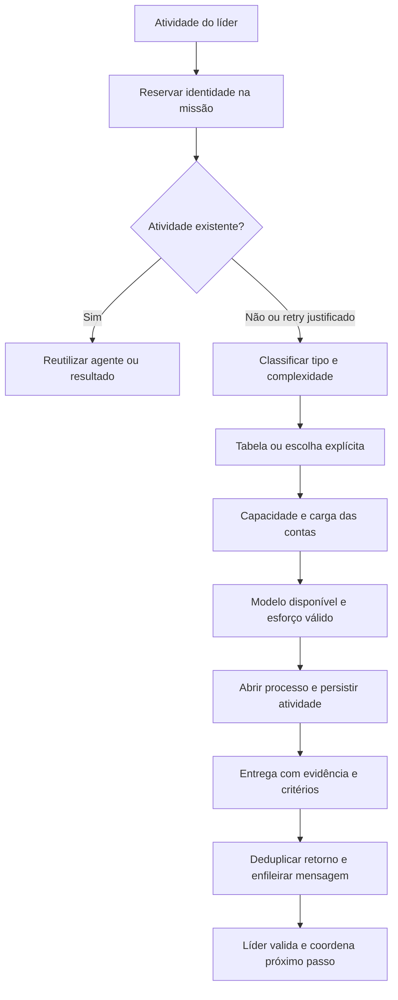

# Orbit ADE — refinamento implementado e verificação

14/10/2026. Análise do checkout inicialmente em `0481897`, seguida de alterações locais. O trabalho preserva a arquitetura Tauri + React + sidecar Node + CLIs em PTYs. O comparativo com a instalação do Overclock está em [overclock-comparison.md](/Users/lucas/Documents/GitHub/Orbit/docs/analysis/overclock-comparison.md).

## Diagnóstico e mudanças

| Gargalo observado no código original | Mudança implementada | Evidência |
|---|---|---|
| `MAESTRO_RULE` era injetado em cada prompt do Claude/Gemini e em cada envio ao Codex/Antigravity | Papel instalado no nascimento da conversa; mensagens posteriores carregam conteúdo novo. Bloqueios de edição e escopo MCP continuam no servidor | [prompts.ts](/Users/lucas/Documents/GitHub/Orbit/packages/sidecar/src/prompts.ts), testes maestro/leadership |
| Dois spawns da mesma tarefa abriam dois processos, inclusive com classificação assíncrona | Reserva por identidade antes de qualquer classificação; chamadas concorrentes aguardam a mesma abertura | [core.ts:1436](/Users/lucas/Documents/GitHub/Orbit/packages/sidecar/src/core.ts:1436), regressão demonstrou `3 !== 2` antes da correção |
| Fechar um agente eliminava a referência operacional à atividade | Registro durável de identidade, agente, aceite, justificativa e resultado; atividades concluídas conservam seu estado quando o terminal recebe outro trabalho | [store.ts](/Users/lucas/Documents/GitHub/Orbit/packages/sidecar/src/store.ts), adaptive.test |
| Repetir um handoff acordava o líder e registrava o mesmo retorno novamente | Conteúdo/status/destino da última entrega são comparados antes de emitir outro evento | [core.ts](/Users/lucas/Documents/GitHub/Orbit/packages/sidecar/src/core.ts), regressão demonstrou `2 !== 1` antes da correção |
| Paste de vários retornos se intercalava antes dos respectivos Enters; Enter atrasado podia atingir uma sessão substituta | Fila por processo, separação paste/Enter, agrupamento de mensagens pendentes e cancelamento ao encerrar | [panes.ts:150](/Users/lucas/Documents/GitHub/Orbit/packages/sidecar/src/panes.ts:150), submission.test reproduziu os dois problemas antes da correção |
| Dificuldade só mudava se o líder a informasse ou se o classificador remoto fosse consultado | Política local de escopo/risco, aplicada mesmo com `kind` conhecido; operações simples dispensam o classificador remoto | [maestro.ts:66](/Users/lucas/Documents/GitHub/Orbit/packages/sidecar/src/maestro.ts:66), complexity/adaptive/table |
| Codex só alterava esforço, sem escolher um modelo leve anunciado pelo CLI | Seleção de famílias leves/avançadas presentes no catálogo; famílias desconhecidas mantêm o modelo configurado | [maestro.ts:113](/Users/lucas/Documents/GitHub/Orbit/packages/sidecar/src/maestro.ts:113), testes com catálogo sintético e níveis próprios por modelo |
| Lotes aguardavam cada classificação antes de iniciar a seguinte | Classificações concorrentes, recibos na ordem do pedido e lançamento síncrono que observa a carga atual de contas | [mcp.ts](/Users/lucas/Documents/GitHub/Orbit/packages/sidecar/src/mcp.ts), table.test verifica pico de duas classificações e nenhuma chamada extra para duplicata |
| Campo de uma linha, sem anexos e com envio sem confirmação | Compositor com múltiplas linhas, colagem/arrastar/seleção de arquivos, prévias, erros e confirmação de aceitação pelo sidecar | [MessageComposer.tsx](/Users/lucas/Documents/GitHub/Orbit/apps/desktop/src/components/MessageComposer.tsx), QA visual e teste WebSocket |
| Ditado dependia da disponibilidade de Web Speech no WebView | Helper Swift Speech/AVFoundation, integrado por comandos/eventos Tauri e com isolamento por sessão | [Dictation.swift](/Users/lucas/Documents/GitHub/Orbit/apps/desktop/src-tauri/native/Dictation.swift), [dictation.rs](/Users/lucas/Documents/GitHub/Orbit/apps/desktop/src-tauri/src/dictation.rs) |
| Toda leitura das respostas dependia do terminal | Visão de conversa para Claude/Codex com código, rolagem própria e atividade; terminal disponível por alternância | [Conversation.tsx](/Users/lucas/Documents/GitHub/Orbit/apps/desktop/src/components/Conversation.tsx) |

## Como a orquestração decide

A identidade implícita usa tarefa, pasta, papel, tipo e critérios; o título é apresentação. `activityId`, por exemplo `T12`, estabelece uma identidade estável mesmo quando o líder reformula o briefing. Identidades são limitadas à missão. `retryReason` cria uma nova execução justificada; repetir a mesma justificativa reutiliza essa execução. Um processo parado sem concluir pede retomada ou justificativa, em vez de abrir silenciosamente uma duplicata. A deduplicação sem identificador não tenta adivinhar equivalência semântica de textos diferentes.

Operações delimitadas, como iniciar o projeto ou rodar o build, reduzem modelo/esforço. Arquitetura, concorrência, falhas intermitentes e outros sinais de risco elevam recursos. Casos sem sinais suficientes ficam em normal; tarefas ambíguas podem usar o classificador já existente. A avaliação é uma política conservadora, não um modelo treinado de custo/qualidade. O líder pode fornecer contexto adicional por `difficulty`.

O Codex seleciona apenas IDs presentes no catálogo anunciado. A classificação de famílias usa nomes/descrições, preservando o modelo configurado quando não conhece a família. Claude/Gemini conservam a escala já existente no projeto. `model_catalog` fornece capacidades anunciadas, esforços e origem do catálogo sob demanda. A política utiliza faixas relativas e limites de assinatura; **não há preços ao vivo nem benchmarks que comprovem qualidade relativa entre todos os modelos**.

Na criação de missão agêntica, a opção de líder automático aplica a avaliação ao próprio líder. A escolha explícita pode ser mantida desligando a opção. Templates existentes conservam a configuração que tinham. CLIs/modelos explícitos de ajudantes deixam de ser substituídos por balanceamento; falta de capacidade é informada. Esforços continuam limitados ao que o modelo aceita.

Um comando simples pede um ajudante. Escopos independentes podem usar até oito no lote; dependências e arquivos compartilhados continuam orientando a divisão feita pelo líder. Há nova checagem do limite de sub-ajudantes depois da classificação assíncrona. O planejamento de dependências ainda depende do líder; não foi introduzido um executor formal de DAG.

## Comunicação, arquivos e voz

O desenho mantém os tokens de cor, Geist, superfícies e densidade existentes. O foco é escrever uma instrução com contexto visível e destino inequívoco (`#agente`). Foram substituídos o campo de uma linha por um compositor, anexos invisíveis por prévias/remover e leitura exclusiva no terminal por uma visão de conversa. Estado, identidade dos agentes, critérios, branches, tokens e retornos continuam compondo a bancada do Orbit.

Enter envia; Shift+Enter quebra linha; composição IME não dispara envio. Rascunhos e anexos permanecem ao trocar de agente enquanto a missão está montada. Seleção, drag/drop e colagem de imagem usam o mesmo fluxo. Até oito arquivos, 4 MB cada e 8 MB por mensagem. São arquivos locais privados, fora do código do projeto; o sidecar valida bytes, gera IDs próprios e exige que cada referência pertença à missão. Apagar a missão remove os anexos. O modelo precisa inspecionar os caminhos por suas ferramentas de arquivo/imagem; isto não garante visão em modelos sem essa capacidade.

Confirmação de envio significa **aceitação na fila local**, não conclusão do modelo. Erro mantém o rascunho. O fluxo foi verificado com arquivos sintéticos e agentes simulados, sem enviar dados do usuário a provedores. Claude/Codex têm conversa baseada em seus arquivos de sessão; ferramentas/PTYs continuam no terminal e atividades estruturadas no fluxo. Gemini/Antigravity ainda dependem do terminal para o conteúdo da conversa.

No app macOS, o helper pede permissões de fala/microfone, fornece texto parcial/final e encerra a captura em até 60 segundos. O reconhecimento é local quando o sistema anuncia suporte; caso contrário, pode usar a Apple. Esse limite segue a documentação de [supportsOnDeviceRecognition](https://developer.apple.com/documentation/speech/sfspeechrecognizer/supportsondevicerecognition) e [requiresOnDeviceRecognition](https://developer.apple.com/documentation/speech/sfspeechrecognitionrequest/requiresondevicerecognition). Não é salvo áudio. No navegador permanece Web Speech, quando disponível. A integração nativa requer macOS 12 ou superior e Swift no build.

**Limite de verificação da voz:** Swift e Rust foram compilados, o protocolo JSON passou no self-test e o app foi empacotado. Não houve concessão automática de permissões nem captura do microfone nesta sessão. Reconhecimento real, atribuição das permissões ao bundle e comportamento após suspensão precisam de teste manual no app.

## Verificação

As regressões principais foram demonstradas antes da correção: abertura duplicada, handoff duplicado, pastes simultâneos e Enter enviado a processo substituto. Os testes de integração usam sidecar, WebSocket, MCP, armazenamento e PTYs reais, com CLIs simulados e homes temporários.

- `npm test`: 97/97 testes do sidecar e 2/2 do desktop, zero falhas, exit 0.
- `npm run typecheck`: protocolo, sidecar e desktop sem erros.
- `cargo check --manifest-path apps/desktop/src-tauri/Cargo.toml --offline`: compilação nativa concluída.
- Helper Swift compilado e executado com `--self-test`: emitiu texto/final e encerramento, exit 0, sem iniciar captura.
- `npm run tauri -w @orbit/desktop -- build --debug`: app de teste empacotado; bundle em `apps/desktop/src-tauri/target/debug/bundle/macos/Orbit.app`.
- QA no browser: conversa, código, anexos de imagem/texto, Shift+Enter, troca de agente preservando rascunho, confirmação de envio limpando anexos/texto; console sem erros nesse fluxo. Sem rolagem horizontal nas larguras 375, 768, 1024 e 1440 pixels.
- `git diff --check`: sem problemas de whitespace.

## Limites e próximos pontos de engenharia

O comparativo local do Overclock distingue contratos documentados, código legível e inferências. Seu núcleo principal é bytecode e não foi decompilado. A [continuação da investigação](overclock-runtime-followup.md) acrescenta auditoria do repositório REA, execução do analisador sobre fontes legíveis e observação da interface do aplicativo em execução. Nenhum código do Overclock foi incorporado ao Orbit. Práticas como não repetir mutações cegamente, instalar papéis no nascimento e dar recibos explicáveis informaram o desenho.

As melhorias são verificáveis, mas não comprovam paridade completa com Codex/Claude nem produtividade superior em projetos reais. Não houve benchmark de economia de tokens, avaliação de qualidade por modelo ou validação de projetos completos com modelos reais. O cenário básico de leitura e entrega MCP foi posteriormente validado com Claude e Codex reais, conforme o relatório de continuação. A validação dos resultados permanece responsabilidade do líder/revisor com comandos/evidências; exigir texto de evidência não comprova sozinho que um agente executou aquele comando. O sandbox Codex e os hooks de edição Claude também têm alcances diferentes: negar ferramentas de edição do Claude não constitui sandbox completo de comandos shell. Integração de branches pelo líder em sandbox só leitura merece um fluxo dedicado.

Prioridades subsequentes: testar ditado real no bundle; validar tarefas completas com Claude/Codex reais; tornar capacidades/custos desconhecidos configuráveis com origem/versionamento; medir duplicações, latência, tokens e qualidade por atividade; formalizar dependências e integração de worktrees sem ampliar poderes de execução do líder.

As mudanças estão no working tree e há um bundle de teste. Não foi criada uma nova release nem substituída a instalação do usuário.
