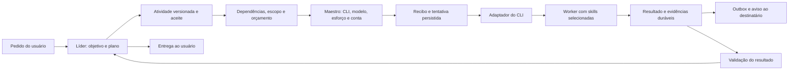

# Overclock → Orbit: harness, adaptadores e eficiência

> Continuação: as correções R0 foram aplicadas; ver [relatório de implementação](../plans/2026-10-14-orbit-harness/implementation-r0.md). Os resultados abaixo registram a investigação anterior às correções.

14/10/2026. Escopo esclarecido pelo usuário: “traduções” significa adaptação entre agentes e harness. Tradução de idioma não integra esta proposta. Esta etapa reutiliza as [evidências REA](rea-evidence/index.json), acrescenta leitura de recursos embarcados e reproduções offline no core do Orbit. Nenhum núcleo `.jsc` foi decompilado; nenhum projeto ou configuração pessoal do Overclock foi alterado.

## O que forma o harness

O modelo sugere ações; o harness mantém identidade, permissões, estado, ferramentas, transporte, orçamento e continuidade. No Orbit proposto, o maestro escolhe a configuração de execução; o líder planeja e julga entregas; o motor aplica os contratos mesmo quando o líder erra. São responsabilidades diferentes.

Esse é o desenho proposto para o Orbit, não um diagrama recuperado do bytecode do Overclock.

## Overclock: cadeia reconstruída e qualidade da evidência

Prefixo dos manuais: `/Applications/Overclock.app/Contents/Resources/resources/arsenal/skills/`. Prefixo do conector: `/Applications/Overclock.app/Contents/Resources/sidecar/arms-mcp/`.

| Fronteira | O que a evidência estabelece | Fonte e alcance |
|---|---|---|
| Pedido → piloto | Piloto define atividades e paralelismo; não há equipe ou fases fixas obrigatórias no modo agêntico | `oc-pilot/SKILL.md:13–33`; contrato embarcado |
| Plano → objetivo/diretório | Atualizar objetivo e `workDir` afeta contexto/nascimento de próximos panes | `oc-mcp/SKILL.md:601–606`; não prova atualização de workers em curso |
| Tipo → configuração efetiva | Tipo resolve CLI, modelo, esforço, skills e persona; recibo informa escolha e fallback | `oc-mcp/SKILL.md:150–170,267–285`; contrato, não algoritmo recuperado |
| Edição da tabela → concorrência | Batch all-or-nothing; `harness_table_changed` exige reler e reenviar; troca de CLI limpa campos incompatíveis omitidos | `oc-mcp/SKILL.md:174–199`; contrato relevante para revisões concorrentes |
| Reconexão → identidade | `paneSessionUrl` preserva caller, criador, leaf, delegateOnly, papel e missão | `proxy.js:126–144`; código legível, coberto pelo escopo REA `ev_e6b1ad96979e7b0b9cdd5b9ebc40e605a89a53c17c2dfa74f27a0f649d2683f7` |
| Recuperação → autoridade | HTTP 406 não vira conexão anônima; isso apagaria identidade e orçamento de filhos | `proxy.js:328–336`; código legível |
| Transporte → resultado | Parser JSON/SSE determinístico; timeout distingue indisponibilidade e execução incerta | `proxy.js:57–105,314–354`; não é reparação semântica por LLM |
| Execução → aceite | `expect.schema` valida entrega, com devolução ao mesmo worker | `oc-mcp/SKILL.md:254–261`; contrato; enforcement central opaco |
| Progresso → wake | `progress` registra sem acordar; `to` pode encaminhar ao revisor | `oc-mcp/SKILL.md:337–348,585–594`; contrato |
| Revisão → continuidade | Piloto revisa referências/diffs/evidência; worker fechado pode retomar conversa | `oc-pilot/SKILL.md:65–68,95–106`; contrato |
| Interrupt → novo plano | Cancela entradas/retries pendentes preservando sessão | `oc-mcp/SKILL.md:617–624`; contrato |

O conector separa retry de consultas e envio único de mutações (`boardRelay.js:201–217`). Repetir uma chamada cujo resultado se perdeu pode duplicar efeitos. O Orbit deve consultar o recibo durável de uma operação antes de tentar executá-la novamente.

### Descobertas que mudam o planejamento

- `resources/qa-swarm/PLAYBOOK.md:34–45` recomenda um coordenador persistente por função, reutilizado em follow-ups. Isso reduz reconstrução de contexto quando o escopo continua válido. É prática específica desse squad, não regra para toda tarefa.
- `resources/qa-swarm/agents/qa-swarm-observer.md:15–27` combina ausência de atividade, ausência de handoff e ausência de prompt ocioso para suspeitar de travamento. Terminal silencioso sozinho não basta.
- `oc-mcp/SKILL.md:560–563` documenta restrições de `expect`, `resume` e `toolProfile` por item no batch. O Orbit deve conservar critérios por atividade também no lote.
- `oc-mcp/SKILL.md:483–484` distingue ocultação de ferramentas e autorização. Um catálogo filtrado não substitui um gate no handler.
- `oc-mcp/SKILL.md:554` permite filhos sem teto quando omitido o limite. O Orbit proposto terá limites globais e por missão explícitos.
- Há divergências entre manuais: `overclock-squad-team-assembly/SKILL.md:72` orienta gerar id/data; `oc-mcp/SKILL.md:102–110` diz deixar isso para o app. O documento histórico [overclock-harness.md](../reverse-engineering/overclock-harness.md) também contém hipóteses pelos nomes de hooks. Esses materiais orientam perguntas; não certificam o handler atual.

### Pistas que permanecem desconhecidas

No bytecode `sidecar/dist/index.jsc`, literais `handoff.poke_deduped` (offset 4.359.068), `handoff.poke_retry` (4.365.781), `handoff.wake_undelivered` (5.591.105) e mensagem de handoff sem id durável após desconexão SSE (1.780.333) sugerem separação entre entrega e wake. Não revelam algoritmo, janela, persistência ou garantia. O núcleo continua opaco; REA analisou somente o loader de 132 bytes em `dist`, Evidence `ev_72b3ec0c7ea3c3abeeaad5a1ded1c660354f713d9e54ed19faf6dffba282eac1`.

## Orbit: o que já existe e onde adaptar melhor

| Tema | Implementação atual | Evolução proposta |
|---|---|---|
| Identidade | `core.ts:1426–1455`: chave de atividade e reserva concorrente; ledger embute Pane | Atividade, tentativa, sessão e resultado com identidades separadas |
| Maestro | `core.ts:1471–1489,1945–2038`: regra local, classificador opcional, overrides, conta e tier | Recibo estruturado com revisão de política e catálogo; decisão reproduzível |
| Eventos | `hooks.ts:45–72`: Gemini convertido para vocabulário Claude; Codex lido por rollout em `core.ts:1785` | Evento canônico independente de provedor; adaptador declara fonte e capacidades |
| Mensagem | `panes.ts:150–166`: aceitação em fila local e coalescência | ACK local distinto de processamento pelo agente; outbox e replay duráveis |
| Entrega | `core.ts:1705–1758`: status, critérios declarados, texto de evidência e wake | Evidência vinculada à revisão, validação independente conforme risco |
| Retomada | `core.ts:2143–2165`: sessão/modelo/effort preservados | Baseline de uso e obrigação preservados; epoch rejeita eventos atrasados |
| Consulta de resultados | `mcp.ts:235–237`: todos os handoffs disponíveis | Cursor, ids, summary/full e detalhe por referência |
| Contexto | `core.ts:722–763,2085`: concatenação e corte em 18 mil caracteres | Cotas por seção; objetivo, restrições e obrigações nunca removidos pelo corte |
| Skills | `skills.ts:55–74,169–171,202–225`: catálogo, descoberta parcial e gate Claude | Pacotes próprios, hash, origem, capacidade de descoberta e auditoria de carga |

As linhas são do checkout local desta investigação; mudanças anteriores permanecem não commitadas. O terminal continua acessível para confiança inicial, autenticação e diagnóstico. A interface de conversa não deve ocultar espera por autorização.

## Dois problemas reproduzidos, ainda não corrigidos nesta rodada de planejamento

Comando: `node docs/plans/2026-10-14-orbit-harness/reproduce-current.mjs`. Usa core real, homes vazios, runner offline e PTYs `/bin/sh`; nenhum modelo real.

| Caso | Resultado observado | Consequência |
|---|---|---|
| `progress` seguido de saída natural do worker | status `exited`, obrigação continua atribuída, `missionReady(force=false)` aceita | Trabalho incompleto pode desaparecer do gate por depender da vida do processo |
| Mesmo report cumulativo depois de resume | 1.100 tokens tornam-se 2.200 | Orçamento/ledger podem contar uso antigo novamente |

Causas: `core.ts:1649` só trata null como entrega devida; `core.ts:1620` só examina helpers vivos; `panes.ts:99` começa com uso null e `core.ts:2163` restaura sessão sem baseline. A suíte de 99 testes da rodada anterior passou, mas não cobria esses cenários. O [primeiro plano de execução](../plans/2026-10-14-orbit-harness/01-session-accounting.md) abre pela contabilização; entrega pendente é o gate seguinte.

## Skills: preparar não significa injetar tudo

O inventário do arsenal embarcado contém 38 `SKILL.md`. Os manuais documentam disponibilização no boot e filtro por tarefa (`oc-mcp:288–305`, `oc-guide:174–185`); isso não prova que os 38 conteúdos entram no prompt. Plugins podem continuar visíveis mesmo quando bloqueados.

No Orbit, a proposta é preparar um pacote próprio de cinco papéis, mantendo somente índice curto na descoberta. A atividade seleciona papel e método; o conteúdo necessário é carregado uma vez, identificado por hash. Referências adicionais entram sob demanda. Não instalar nem substituir skills globais do usuário. Os [rascunhos originais](../plans/2026-10-14-orbit-harness/skill-drafts) foram escritos para essa direção, sem copiar os textos do Overclock.

## Como buscar economia sem degradar a entrega

1. Consertar contagem e distinguir custo desconhecido de zero antes de comparar.
2. Evitar refazer atividade concluída e reconstruir contexto em coordenador novo sem necessidade.
3. Consultar deltas/resumos; carregar logs, diffs e evidências completos por referência.
4. Reduzir catálogo e ferramentas expostos por papel quando o CLI suportar; aplicar autorização no handler independentemente da exposição.
5. Usar regra local e operação determinística para trabalho mecânico; reservar decisor/modelo maior para ambiguidade e risco.
6. Definir paralelismo por independência, conflitos e orçamento; cada worker acrescenta startup/contexto.
7. Medir custo total até aceite, incluindo classificação, revisão, retries e retomadas.

Essas direções são coerentes com a orientação de contexto mínimo e descoberta progressiva da [Anthropic](https://www.anthropic.com/engineering/effective-context-engineering-for-ai-agents). Seu estudo de [harnesses longos](https://www.anthropic.com/engineering/effective-harnesses-for-long-running-agents) enfatiza progresso incremental e artefatos de continuidade, sem estabelecer que mais agentes sejam sempre melhores. A análise de [execução com MCP](https://www.anthropic.com/engineering/code-execution-with-mcp) discute reduzir dados intermediários no contexto; no Orbit, a primeira aplicação será seleção/paginação determinística, sem adicionar execução arbitrária ao líder. Não se transportam percentuais desses estudos para metas já alcançadas no Orbit.

## Cobertura desta etapa

| Pergunta | Estado |
|---|---|
| Como piloto decompõe e delega | Contratos reconstruídos; motor privado não recuperado |
| Como a identidade atravessa transporte | Código legível analisado; não houve injeção de falha no Overclock vivo |
| Como resultados/retomada deveriam se coordenar | Contratos + pistas; garantias internas desconhecidas |
| Onde o Orbit perde obrigação ou reconta tokens | Reproduzido offline no core real |
| Como reduzir contexto/skills | Proposta com arquivos e critérios; ganho ainda não medido |
| Visual e mascote | Conceito e protótipo separados; não instalados no app |

O [roteiro consolidado](../plans/2026-10-14-orbit-harness/README.md) organiza as próximas entregas e os gates de aceitação.
