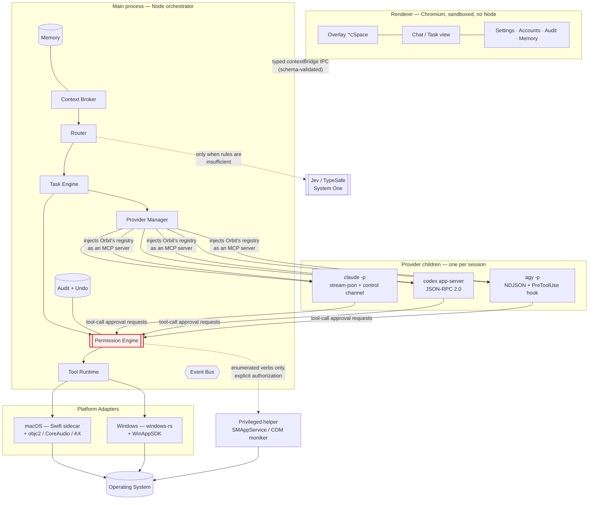

# Orbit — Architecture Overview

> Status: Phase 0 (architecture). No implementation exists yet. Every claim below carries
> a label — `[VERIFIED-CLI]` (observed in a locally installed binary), `[DOCUMENTED]`
> (official vendor docs), `[COMMUNITY]` (third-party, not vendor-confirmed), `[INFERRED]`
> (our synthesis), or `[PROPOSED]` (a decision made in this document, not yet built).
> The full research trail lives in the Phase 0 plan at
> `/Users/lucas/.claude/plans/orbit-architecture-crystalline-fairy.md`; this file is the
> durable summary.

## What Orbit is

Orbit is a personal computer agent for macOS and Windows: a desktop application that
observes permitted machine state, interprets natural-language requests (text now, voice
later), and executes real actions on the operating system. It is explicitly not a chatbot
and explicitly not a local-LLM host.

## The three-tier intelligence budget

| Tier | Used for | Cost |
| --- | --- | --- |
| Deterministic code | "open Spotify", "volume 50%" | ~0 |
| **Jev** (TypeSafe System One) | intent, routing, ranking, ambiguity, risk signals | ~$0.042/Mtok, 70–500 ms |
| **Agent provider** (Claude Code / Codex / Antigravity) | real reasoning + generation | slow, expensive |

An LLM is called only when neither of the cheaper tiers suffices. [PROPOSED]

## How a request flows

```
User (text/voice)
  → Context Broker (minimal, filtered snapshot)
  → Router
      1. Deterministic rules (exact aliases, unambiguous verbs) — no network
      2. Jev (speculative fan-out: intent + tool ranking + args + risk signals)
      3. Agent provider (Claude Code / Codex / Antigravity) — only if reasoning is needed
  → Permission Engine (the single chokepoint to the OS)
  → Tool Runtime → Platform Adapter (macOS / Windows) → Operating System
  → Audit Log (append-only) + Undo registration
```

See [providers.md](./providers.md), [jev.md](./jev.md), [tools.md](./tools.md),
[permissions.md](./permissions.md) for the detail behind each stage.

## System diagram



The red node is the invariant: **every path to the OS passes through the Permission
Engine.** No agent provider, no native tool, and no internal module bypasses it.

## Core architecture decisions (see the ADRs for full reasoning)

- **Desktop stack: Electron**, gated on a measured spike against Tauri 2 — [ADR-0001](../adr/0001-desktop-stack.md).
  This contradicts the original hypothesis; see the ADR for why.
- **Language split**: TypeScript orchestrator, Rust (napi-rs) for OS-native tool bindings,
  a Swift sidecar for macOS-only APIs — [ADR-0002](../adr/0002-language-split.md).
- **Provider integration**: speak each provider's own protocol directly; treat the official
  SDKs as executable specifications, not runtime dependencies — [ADR-0003](../adr/0003-provider-protocol-strategy.md).
- **Secrets**: Orbit stores almost no credentials. Providers keep their own, isolated by
  config directory — [ADR-0004](../adr/0004-no-credential-storage.md).
- **Security**: the Permission Engine is the single chokepoint to the OS —
  [ADR-0005](../adr/0005-permission-engine-chokepoint.md).
- **Jev's role is bounded**: it may only escalate computed risk, never grant permission or
  compute risk itself — [ADR-0006](../adr/0006-jev-risk-boundary.md).
- **No hardcoded models or efforts** — runtime discovery with an alias floor —
  [ADR-0007](../adr/0007-dynamic-model-discovery.md).
- **MCP is the single tool-distribution channel** to every provider —
  [ADR-0008](../adr/0008-mcp-as-tool-channel.md).
- **Structured memory, no vector DB** until a measured retrieval failure demands one —
  [ADR-0010](../adr/0010-structured-memory-no-vectors.md).
- **Antigravity ships opt-in, disclosed, single-account** —
  [ADR-0011](../adr/0011-antigravity-opt-in.md).
- **Developer ID + notarized distribution**, not the Mac App Store —
  [ADR-0012](../adr/0012-developer-id-distribution.md).

Full ADR index: [docs/adr/](../adr/).

## Cross-cutting constraints discovered during research

1. **Two of three providers restrict subscription-backed automation.** Anthropic's Agent SDK
   terms prohibit third parties from offering claude.ai login/rate limits without prior
   approval; Google's Antigravity FAQ states third-party access is a ToS violation, with the
   risk landing on the *user's* account. See [providers.md](./providers.md) §Licensing and
   [security.md](./security.md).
2. **macOS needs a signed `.app` bundle plus a Swift sidecar — not optional.**
   Notifications, Screen Recording (on Tahoe 26.1+), `SpeechAnalyzer`, and
   `SMAppService`+XPC are all Swift-first or bundle-gated. See [voice.md](./voice.md) and
   [tools.md](./tools.md).
3. **Effort is a per-model property, not a global enum**, confirmed independently on both
   Claude Code (Opus 5 has `xhigh`, Opus 4.6 does not) and Codex (`gpt-6-astra` has
   `max`/`ultra`, `gpt-5.5` does not). See [providers.md](./providers.md) §Model & Effort.
4. **Both platforms in the MVP roughly doubles Tool Runtime effort** and requires real
   testing on a Windows machine — this was Lucas's explicit choice, recorded honestly in
   [roadmap.md](../roadmap.md).

## Document map

| Doc | Covers |
| --- | --- |
| [providers.md](./providers.md) | Claude Code, Codex, Antigravity — protocols, auth, licensing, capability matrix |
| [tools.md](./tools.md) | Tool Runtime, registry, platform adapters, capability tiers |
| [permissions.md](./permissions.md) | Risk classes, autonomy modes, interception points per provider |
| [security.md](./security.md) | Threat model, trust boundary, OWASP ASI mapping |
| [jev.md](./jev.md) | TypeSafe/Jev integration — question catalogue, boundaries, degradation |
| [voice.md](./voice.md) | Voice pipeline architecture (post-MVP, designed now) |
| [context.md](./context.md) | Context Broker, privacy filter |
| [memory.md](./memory.md) | SQLite-backed structured memory |
